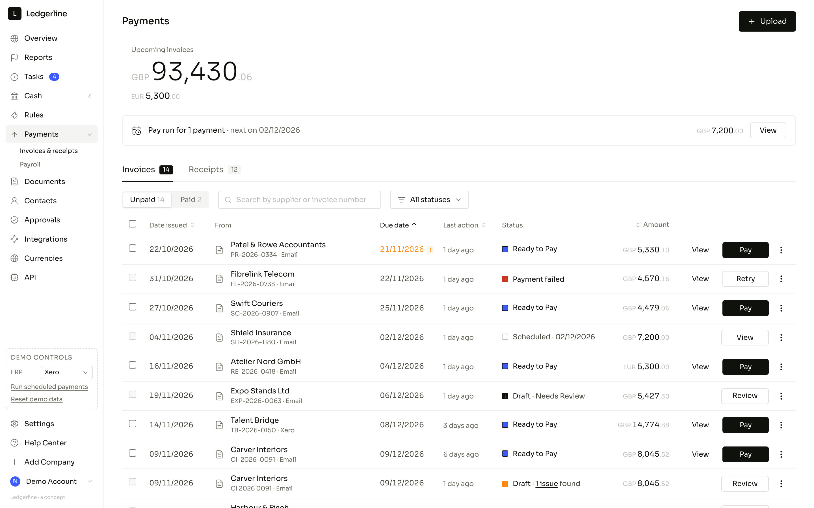
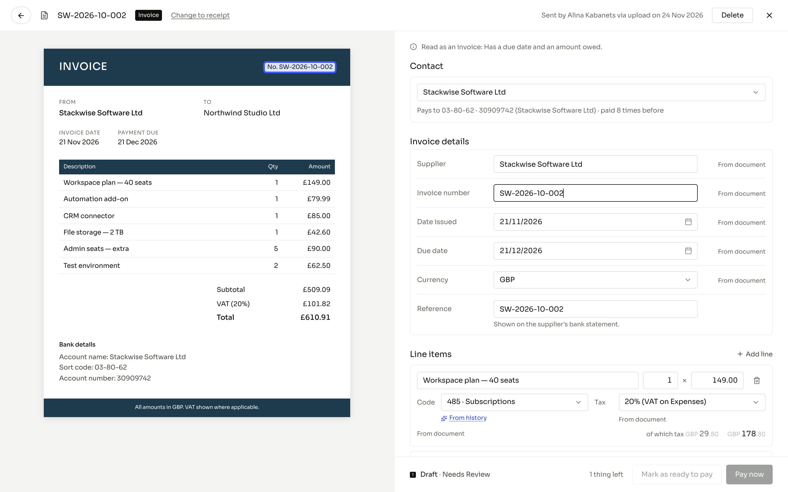
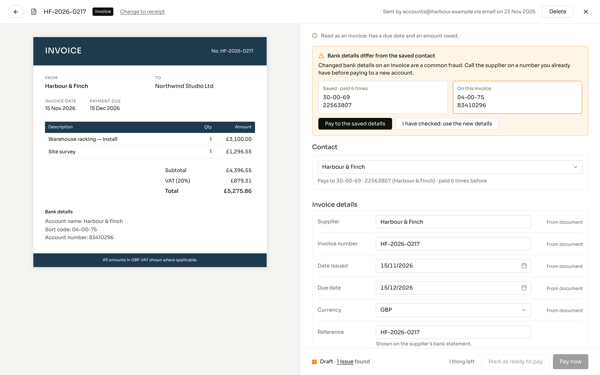
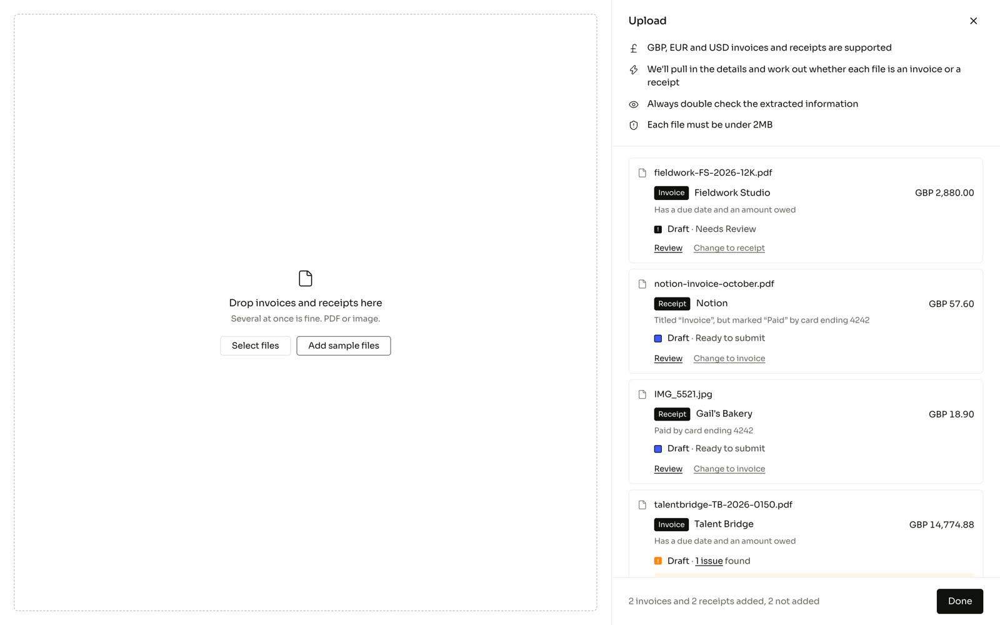
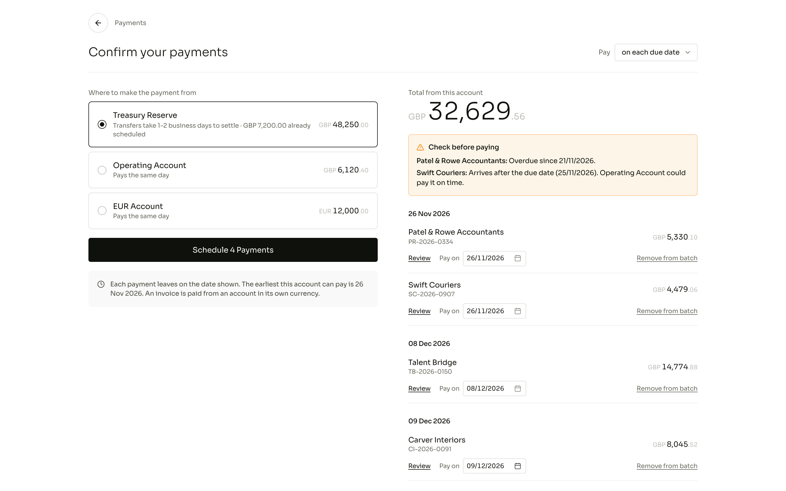

# Ledgerline

**One payments queue for supplier invoices and receipts.** A concept for a B2B finance
platform, designed and built end to end: research, design, and a working Next.js app with
a tested domain model.

**[Live demo](https://ledgerline-tawny-nu.vercel.app)** · **[Design process deck](https://ledgerline-tawny-nu.vercel.app/design-process.html)** · **[Code walkthrough](docs/WALKTHROUGH.md)**



> Originally a take-home task for a fintech company, shared with their permission and
> anonymised: the product name, look, sample data and wording are my own. The git history
> is the original build history, replayed with the anonymised code.

## The problem

A B2B finance platform lets companies pay supplier invoices straight from their treasury
account. Customers started sending receipts too (by email, by WhatsApp, from their
accounting system), and receipts were squeezed into the invoice screens. But the two are
different documents:

- **An invoice** is a request for payment. It needs a supplier with bank details, GL and
  tax codes on each line, and it goes **Draft → Ready to Pay → Paid**.
- **A receipt** is proof of something already paid. It needs only a merchant name, starts
  as one line that can be itemised, and goes **Draft → Submitted**.

The task: one page that takes both to their end state, uses AI to remove the typing, and
is ready for more accounting systems (NetSuite, Campfire, Light) later.

## What I built

| Screen | What it does |
| --- | --- |
| Payments | Invoices and receipts in two tabs, each with a count of what needs action. Sort, filter by state, search across both, pay or submit several at once. A pay-run banner for what is scheduled. |
| Upload | Drop several files. Each shows what it was read as and why, or why it failed. One bad file never blocks the rest. |
| Review | The document beside the fields. Every extracted value says where it came from; uncertain ones stay flagged until a person confirms them. GL and tax codes per line; receipts can be itemised. |
| Confirm payments | Choose the account, see the balance against the total and what is already scheduled, change dates. Anything unusual is listed first. |
| Scheduled | What happens next. Invoices move to Processing, then Paid, then sync to the ERP. |

| | |
| --- | --- |
|  |  |
|  |  |

## Decisions worth explaining

- **Two tabs, not one mixed list.** The columns, the bulk action and the headline number
  all differ between invoices and receipts. Tabs bring three problems, and each has an
  answer: the upload panel says where every file went, each tab shows a count, and search
  covers both.
- **A strict state machine.** Every change of state goes through one function,
  [`transition()`](src/lib/transitions.ts). A screen can hide a button, but only that
  function decides whether a move is allowed, so no screen can skip a state or pay twice.
- **"Paid" means the money has gone.** Between Ready to Pay and Paid an invoice is
  Scheduled, Processing or Payment failed. A failed payment returns the money.
- **The state in words, then the reason:** "Draft · Needs Review", "Draft · 2 issues found".
- **Money in whole pence.** No floating-point arithmetic touches an amount; tax rates are
  whole percentages.
- **Accounting systems behind an adapter.** GL codes, tax codes and required fields come
  from [`erp.ts`](src/lib/erp.ts). Two mocks show the seam: Xero, and NetSuite, which names
  codes differently and needs a department on every line. Switch between them in the
  sidebar's demo controls.

## AI that earns trust

The extraction is scripted in this build; the patterns around it are real.

- **AI never moves money.** Paying and submitting are always a person's action.
- **Every value shows its source:** from the document, from history, edited by you, or not found.
- **Only uncertain values are flagged**, with the reason, until a person confirms or edits them.
- **Bank details are never taken from a document.** They are compared with the saved
  contact, and a difference blocks payment. A new contact's details are typed by a person.
- **The type is decided by evidence of payment, not the title.** A subscription "invoice"
  already paid by card is a receipt; paying it would be paying twice.
- **Tax is never assumed.** No VAT on the document means "No VAT".

## Edge cases

About 30, most with an example in the demo data: unreadable files, documents that are
neither, duplicates (ignoring spacing in the number, but not flagging monthly
subscriptions), totals that don't add up, tax that doesn't match its code, changed bank
details, a contact that isn't the supplier, credit notes, foreign currency, not enough
funds, a due date sooner than the money can leave, double clicks and two browser tabs,
failed payments and failed syncs, and a refresh in the middle of any of them. The full list
is in the [design process deck](https://ledgerline-tawny-nu.vercel.app/design-process.html).

## Beyond finance

The same patterns carry to other dense, high-stakes queues:

- **Supply operations:** purchase orders, delivery notes and invoices matched three ways,
  with exceptions surfaced first.
- **Regulatory and compliance work:** filings with evidence behind each value, flags that
  must be cleared, and an audit trail of who changed what.
- **What transfers:** a queue sorted by what needs a person, provenance on every value, a
  strict state machine, batch actions that refuse what isn't ready, and adapters for the
  systems around it.

## Built with

Next.js 16 (App Router), React 19, TypeScript, Tailwind CSS 4, Vitest. No component
library: a small set of components, including an accessible dropdown and date picker.

```bash
pnpm install
pnpm dev        # http://localhost:3000
pnpm test       # 65 tests: rules, state transitions, type changes, money and line arithmetic
```

Everything behind the UI is mocked and saved in the browser. "Reset demo data" in the
sidebar starts again.

## What is not here

- No backend or real extraction: [`api.ts`](src/lib/api.ts) holds the four calls a server
  would answer, with delays and scripted failures.
- Approvals, a full pay-run view, exchange rates and bank holidays are left out.
- Tests cover the logic, not the screens. Built for 1280 pixels wide and up.

## How I worked

Research and design first: sources, personas, an empathy map, journeys worked through on
paper, then the key decisions; the [deck](https://ledgerline-tawny-nu.vercel.app/design-process.html) follows the double
diamond. I built with Claude Code as a pair: I set the direction, made the product
decisions and reviewed; AI wrote much of the code to that plan. Midway I asked it to
review its own code for defects. It found 30, and the fixes are the last build commit.
[`docs/WALKTHROUGH.md`](docs/WALKTHROUGH.md) explains how the code fits together.
